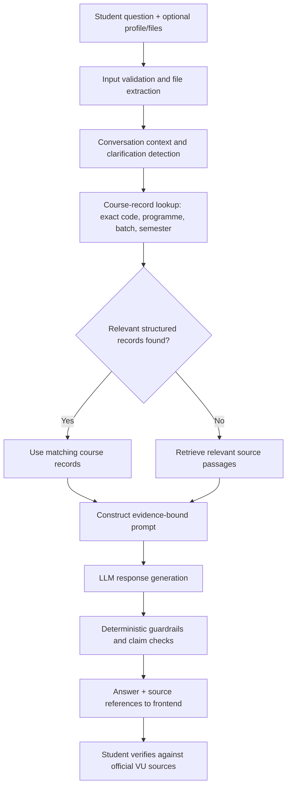

# Agent Pipeline and Model Comparison — A2

## Intended grounded response pipeline

## Model comparison framework
The `benchmark_runner.py` script is configured to use the same benchmark questions and source context for candidate models, record response latency and token usage, and leave human scoring fields blank for independent evaluation. It checks the configured Groq account's available model list and stops if the required ten candidate models are not available; it does not silently substitute paid models.

## Evaluation rubric (human-scored, 0–4 each)
- Factual accuracy against the gold facts
- Grounding in cited VU sources
- No unsupported/hallucinated claims
- Appropriate clarification for missing batch/profile context

**Results status:** No model rankings or score claims are included here. Execute the benchmark, manually score responses, and append the CSV plus an analysis before reporting a winner.
